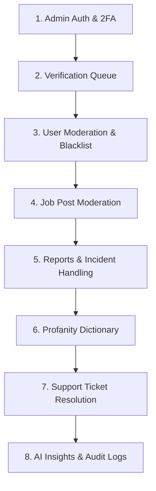

# SIKAP Admin Dashboard — QA API Testing Guide (Postman)

> **Document Version:** 1.0 (Admin Command Center & Backend Verification)  
> **Target Backend:** SIKAP Laravel REST API (`sikap-backend`)  
> **Target Frontend:** Next.js Admin Dashboard (`sikap-admin`)  
> **Base URL Path:** `{{base_url}}/admin` (`http://127.0.0.1:8000/api/v1/admin`)  
> **Companion Collection:** [`SIKAP_API_Postman_Collection.json`](file:///c:/Users/user/.antigravity/capstone%20project/sikap-backend/SIKAP_API_Postman_Collection.json) *(Folder 11: Admin Command Center)*  
> **Companion Environment:** [`SIKAP_Local_Environment.json`](file:///c:/Users/user/.antigravity/capstone%20project/sikap-backend/SIKAP_Local_Environment.json)

---

## 1. QA Test Setup & Environment Variables

Configure the following variables in your Postman Environment before executing the admin test suite:

| Variable | Description | Sample Value / Setup |
|---|---|---|
| `base_url` | Base URL of SIKAP API | `http://127.0.0.1:8000/api/v1` *(or production Render URL)* |
| `admin_token` | Admin Bearer authentication token | Auto-populated by Admin Login / 2FA Verify |
| `reauth_token` | 5-minute elevated token for destructive actions | Auto-populated by Reauth endpoint |
| `target_user_id` | ID of user to verify, suspend, or moderate | e.g. `1` |
| `target_job_id` | ID of job post to moderate or override | e.g. `1` |
| `target_report_id` | ID of user/job incident report to resolve | e.g. `1` |
| `target_ticket_id` | ID of support ticket to reply to | e.g. `1` |
| `target_profanity_id` | ID of profanity dictionary entry | e.g. `1` |
| `target_blacklist_id` | ID of banned identity record | e.g. `1` |

---

## 2. End-to-End QA Execution Flow



---

## 3. Test Cases & API Specifications

---

### Module 1: Admin Authentication, 2FA & Step-Up Reauth

#### TC-ADM-API-001: Admin Login with Credentials
* **Method & URL:** `POST {{base_url}}/admin/auth/login`
* **Headers:**  
  `Content-Type: application/json`  
  `Accept: application/json`
* **Body (raw JSON):**
```json
{
  "email": "admin@sikap.xyz",
  "password": "Password123!"
}
```
* **Expected Status:** `200 OK`
* **Expected Response Shape:**
  * **If 2FA Disabled:**
    ```json
    {
      "token": "3|abcdef123456...",
      "token_type": "Bearer",
      "user": {
        "id": 1,
        "name": "Super Administrator",
        "email": "admin@sikap.xyz",
        "role": "admin",
        "admin_role": "superadmin"
      }
    }
    ```
  * **If 2FA Enabled:**
    ```json
    {
      "mfa_required": true,
      "mfa_token": "a1b2c3d4...",
      "email": "admin@sikap.xyz",
      "message": "Two-factor authentication required. Please enter your 6-digit authenticator code."
    }
    ```
* **Postman Test Script:**
```javascript
pm.test("Admin Login Status 200", function () {
    pm.response.to.have.status(200);
    const res = pm.response.json();
    if (res.token) {
        pm.environment.set("admin_token", res.token);
    } else if (res.mfa_required) {
        pm.environment.set("mfa_token", res.mfa_token);
    }
});
```
* **Negative QA Checks:**
  * Test with non-admin user credentials $\rightarrow$ Expected: `403 Forbidden` (`"Access denied. Administrator privileges required."`).
  * Test with wrong password $\rightarrow$ Expected: `401 Unauthorized` (`"Invalid administrative credentials."`).
  * Test with suspended admin account $\rightarrow$ Expected: `403 Forbidden` (`"Your administrative account is suspended."`).

#### TC-ADM-API-002: Verify 2FA / TOTP Challenge Code
* **Method & URL:** `POST {{base_url}}/admin/auth/mfa-verify`
* **Headers:** `Content-Type: application/json`, `Accept: application/json`
* **Body (raw JSON):**
```json
{
  "mfa_token": "{{mfa_token}}",
  "code": "123456"
}
```
* **Expected Status:** `200 OK`
* **Postman Test Script:**
```javascript
pm.test("MFA Verified and Token Stored", function () {
    pm.response.to.have.status(200);
    pm.environment.set("admin_token", pm.response.json().token);
});
```

#### TC-ADM-API-003: Get Authenticated Admin Profile & Role Permissions
* **Method & URL:** `GET {{base_url}}/admin/auth/me`
* **Headers:**  
  `Authorization: Bearer {{admin_token}}`  
  `Accept: application/json`
* **Expected Status:** `200 OK`
* **QA Validation:** Response includes `user.admin_role` (`superadmin`, `moderator`, or `analyst`) and permissions array (e.g., `manage_users`, `manage_jobs`, `view_analytics`, `resolve_reports`).

#### TC-ADM-API-004: Step-Up Reauthentication (Elevate Privileges for Destructive Actions)
* **Method & URL:** `POST {{base_url}}/admin/auth/reauth`
* **Headers:**  
  `Authorization: Bearer {{admin_token}}`  
  `Content-Type: application/json`
* **Body (raw JSON):**
```json
{
  "password": "Password123!"
}
```
* **Expected Status:** `200 OK`
* **Expected Response:**
```json
{
  "reauth_token": "reauth_random_token_string...",
  "expires_in": 300,
  "message": "Re-authentication successful. Elevated privileges granted for 5 minutes."
}
```
* **Postman Test Script:**
```javascript
pm.test("Reauth Token Acquired", function () {
    pm.response.to.have.status(200);
    pm.environment.set("reauth_token", pm.response.json().reauth_token);
});
```

#### TC-ADM-API-005: Reset Admin Rate Limiter / Throttle Cache
* **Method & URL:** `POST {{base_url}}/admin/auth/reset-throttle`
* **Expected Status:** `200 OK`
* **Expected Response:** `{"status": "success", "message": "Rate limiter cache cleared successfully. You can now log in."}`

---

### Module 2: User Identity Verification Queue Management

#### TC-ADM-API-006: List Pending Verifications Queue
* **Method & URL:** `GET {{base_url}}/admin/verifications?status=pending`
* **Headers:** `Authorization: Bearer {{admin_token}}`
* **Expected Status:** `200 OK`
* **QA Verifications:**
  * Returns an array of users awaiting review.
  * `document_url`, `document_back_url`, and `selfie_url` contain fresh, signed URLs (Supabase storage).
  * `blacklist_matches` array is evaluated against existing banned identities.
* **Postman Test Script:**
```javascript
pm.test("Verification Queue Loaded", function () {
    pm.response.to.have.status(200);
    const users = pm.response.json();
    pm.expect(users).to.be.an('array');
    if (users.length > 0) {
        pm.environment.set("target_user_id", users[0].id);
        pm.expect(users[0]).to.have.property('blacklist_matches');
    }
});
```

#### TC-ADM-API-007: Approve User Identity Verification
* **Method & URL:** `PATCH {{base_url}}/admin/users/{{target_user_id}}/verify`
* **Headers:**  
  `Authorization: Bearer {{admin_token}}`  
  `Content-Type: application/json`
* **Body (raw JSON):**
```json
{
  "status": "approved",
  "rejection_reason": null
}
```
* **Expected Status:** `200 OK`
* **QA Assertions:**
  * Target user's `verification_status` becomes `"approved"`.
  * User's `registration_status` becomes `"approved"`.
  * User's `verification_badge` becomes `true`.
  * Audit log entry created in `ActivityLog`.

#### TC-ADM-API-008: Reject or Request Correction for User Identity
* **Method & URL:** `PATCH {{base_url}}/admin/users/{{target_user_id}}/verify`
* **Headers:** `Authorization: Bearer {{admin_token}}`
* **Body (raw JSON):**
```json
{
  "status": "correction_needed",
  "rejection_reason": "Government ID photo is blurry or cropped. Please upload a clear, full photo."
}
```
* **Expected Status:** `200 OK`
* **QA Assertions:**
  * Target user's `verification_status` becomes `"correction_needed"`.
  * User's `registration_status` reverts to `"pending_id_upload"`.
  * Push notification and email alert are dispatched to the user.

---

### Module 3: User Moderation, Suspension & Account Lifecycle

#### TC-ADM-API-009: List Platform Users with Search & Filters
* **Method & URL:** `GET {{base_url}}/admin/users?role=worker&municipality=Sorsogon City&is_suspended=false&page=1`
* **Headers:** `Authorization: Bearer {{admin_token}}`
* **Expected Status:** `200 OK`
* **QA Assertions:** Returns paginated collection with `total`, `current_page`, and counts (`job_posts_count`, `applications_count`, `reviews_received_count`).

#### TC-ADM-API-010: View Full User Audit Profile & Drill-Downs
* **Endpoints:**
  * `GET {{base_url}}/admin/users/{{target_user_id}}` $\rightarrow$ Profile & credentials summary.
  * `GET {{base_url}}/admin/users/{{target_user_id}}/posts` $\rightarrow$ Created job posts.
  * `GET {{base_url}}/admin/users/{{target_user_id}}/applications` $\rightarrow$ Applied jobs history.
  * `GET {{base_url}}/admin/users/{{target_user_id}}/reviews` $\rightarrow$ Received ratings & reviews.
  * `GET {{base_url}}/admin/users/{{target_user_id}}/reports` $\rightarrow$ Reports filed against or by user.
  * `GET {{base_url}}/admin/users/{{target_user_id}}/logs` $\rightarrow$ User activity history.
* **Headers:** `Authorization: Bearer {{admin_token}}`
* **Expected Status:** `200 OK`

#### TC-ADM-API-011: Suspend User (Temporary / Permanent)
* **Method & URL:** `PATCH {{base_url}}/admin/users/{{target_user_id}}`
* **Headers:** `Authorization: Bearer {{admin_token}}`
* **Body (raw JSON):**
```json
{
  "is_suspended": true,
  "duration": "1_week",
  "suspension_reason": "Repeated unpunctuality and non-compliance with community standards."
}
```
* **Expected Status:** `200 OK`
* **QA Assertions:**
  * Target user `is_suspended` is `true`.
  * `suspended_until` is calculated accurately (7 days from now).
  * User is added to `BannedIdentity` registry.
  * Attempting to log in as this user on the mobile app triggers `403 SuspendedFallback`.

#### TC-ADM-API-012: Unsuspend User
* **Method & URL:** `PATCH {{base_url}}/admin/users/{{target_user_id}}`
* **Headers:** `Authorization: Bearer {{admin_token}}`
* **Body (raw JSON):**
```json
{
  "is_suspended": false
}
```
* **Expected Status:** `200 OK`
* **QA Assertions:** `is_suspended: false`, `suspended_until: null`, `suspension_reason: null`, and `BannedIdentity` record marked `is_active = false`.

#### TC-ADM-API-013: Bulk Suspend Users
* **Method & URL:** `PATCH {{base_url}}/admin/users/bulk-status`
* **Headers:** `Authorization: Bearer {{admin_token}}`
* **Body (raw JSON):**
```json
{
  "ids": [2, 3],
  "is_suspended": true,
  "duration": "1_month",
  "reason": "Coordinated spam activity detected."
}
```
* **Expected Status:** `200 OK`

#### TC-ADM-API-014: Soft Delete and Restore User
* **Soft Delete:** `DELETE {{base_url}}/admin/users/{{target_user_id}}` *(Status: `200 OK`)*
* **Restore User:** `PATCH {{base_url}}/admin/users/{{target_user_id}}/restore` *(Status: `200 OK`)*

#### TC-ADM-API-015: Superadmin Permanent Force Delete (Requires Reauth)
* **Method & URL:** `DELETE {{base_url}}/admin/users/{{target_user_id}}/force`
* **Headers:**  
  `Authorization: Bearer {{admin_token}}`  
  `X-Reauth-Token: {{reauth_token}}`
* **Expected Status:** `200 OK`
* **QA Negative Check:** Omit `X-Reauth-Token` $\rightarrow$ Expected: `401 Unauthorized` (`"Re-authentication required for sensitive destructive action."`).

---

### Module 4: Job Posting Moderation & Controls

#### TC-ADM-API-016: List All Platform Job Posts with Filtering
* **Method & URL:** `GET {{base_url}}/admin/jobs?status=open&search=Carpenter&per_page=15`
* **Headers:** `Authorization: Bearer {{admin_token}}`
* **Expected Status:** `200 OK`
* **Postman Test Script:**
```javascript
pm.test("Capture Target Job ID", function () {
    const res = pm.response.json();
    const jobs = res.data || res;
    if (jobs.length > 0) {
        pm.environment.set("target_job_id", jobs[0].id);
    }
});
```

#### TC-ADM-API-017: Admin Override Job Post Status
* **Method & URL:** `PATCH {{base_url}}/admin/jobs/{{target_job_id}}/status`
* **Headers:** `Authorization: Bearer {{admin_token}}`
* **Body (raw JSON):**
```json
{
  "status": "cancelled",
  "reason": "Misleading compensation or non-compliant terms."
}
```
* **Expected Status:** `200 OK`
* **QA Assertion:** Status updates to `cancelled`. Job is immediately removed from Worker search feed.

#### TC-ADM-API-018: Admin Force-Complete Job
* **Method & URL:** `PATCH {{base_url}}/admin/jobs/{{target_job_id}}/mark-complete`
* **Headers:** `Authorization: Bearer {{admin_token}}`
* **Expected Status:** `200 OK`
* **QA Assertion:** Job status updates to `completed` and the 7-day mutual rating window is unlocked.

#### TC-ADM-API-019: Bulk Job Status Override
* **Method & URL:** `PATCH {{base_url}}/admin/jobs/bulk-status`
* **Headers:** `Authorization: Bearer {{admin_token}}`
* **Body (raw JSON):**
```json
{
  "ids": [10, 11],
  "status": "closed"
}
```
* **Expected Status:** `200 OK`

---

### Module 5: Incident Reports & Live Stream Moderation

#### TC-ADM-API-020: List User & Job Incident Reports
* **Method & URL:** `GET {{base_url}}/admin/reports?status=open&per_page=20`
* **Headers:** `Authorization: Bearer {{admin_token}}`
* **Expected Status:** `200 OK`
* **Postman Test Script:**
```javascript
pm.test("Capture Report ID", function () {
    const res = pm.response.json();
    const reports = res.data || res;
    if (reports.length > 0) {
        pm.environment.set("target_report_id", reports[0].id);
    }
});
```

#### TC-ADM-API-021: Get Open Reports Unread Count
* **Method & URL:** `GET {{base_url}}/admin/reports/unread-count`
* **Headers:** `Authorization: Bearer {{admin_token}}`
* **Expected Status:** `200 OK`
* **QA Assertion:** Returns integer count for dashboard badge notifications.

#### TC-ADM-API-022: Resolve or Dismiss Incident Report
* **Method & URL:** `PATCH {{base_url}}/admin/reports/{{target_report_id}}`
* **Headers:** `Authorization: Bearer {{admin_token}}`
* **Body (raw JSON):**
```json
{
  "status": "resolved"
}
```
* **Expected Status:** `200 OK`
* **QA Assertions:**
  * Report `status` becomes `resolved`.
  * `resolved_at` timestamp is set to current time.
  * Automated email notification dispatched to reporting user.

#### TC-ADM-API-023: Aggregated Municipal & Barangay Demographics Report
* **Method & URL:** `GET {{base_url}}/admin/reports/demographics?municipality=Sorsogon City`
* **Headers:** `Authorization: Bearer {{admin_token}}`
* **Expected Status:** `200 OK`
* **QA Assertion:** Returns aggregate counts for `workers`, `employers`, `jobs`, and `total_impact`.

---

### Module 6: Profanity & Content Moderation Dictionary

#### TC-ADM-API-024: List Profanity Dictionary Words
* **Method & URL:** `GET {{base_url}}/admin/profanity-words`
* **Headers:** `Authorization: Bearer {{admin_token}}`
* **Expected Status:** `200 OK`

#### TC-ADM-API-025: Add Word to Profanity Moderation Filter
* **Method & URL:** `POST {{base_url}}/admin/profanity-words`
* **Headers:** `Authorization: Bearer {{admin_token}}`
* **Body (raw JSON):**
```json
{
  "word": "bastosword",
  "action": "block"
}
```
* **Expected Status:** `201 Created`
* **Postman Test Script:**
```javascript
pm.test("Profanity Word Added", function () {
    pm.response.to.have.status(201);
    pm.environment.set("target_profanity_id", pm.response.json().word.id);
});
```
* **QA Functional Check:** Attempting to post a job or chat message containing `"bastosword"` now triggers HTTP `422 Unprocessable Entity`.

#### TC-ADM-API-026: Delete Word from Profanity Filter
* **Method & URL:** `DELETE {{base_url}}/admin/profanity-words/{{target_profanity_id}}`
* **Headers:** `Authorization: Bearer {{admin_token}}`
* **Expected Status:** `200 OK`

---

### Module 7: Support Ticket Queue & Automated Replies

#### TC-ADM-API-027: List Platform Support Inquiries
* **Method & URL:** `GET {{base_url}}/admin/support`
* **Headers:** `Authorization: Bearer {{admin_token}}`
* **Expected Status:** `200 OK`
* **Postman Test Script:**
```javascript
pm.test("Capture Ticket ID", function () {
    const res = pm.response.json();
    const tickets = res.data || res;
    if (tickets.length > 0) {
        pm.environment.set("target_ticket_id", tickets[0].id);
    }
});
```

#### TC-ADM-API-028: Admin Reply to Ticket & Auto-Resolve
* **Method & URL:** `POST {{base_url}}/admin/support/{{target_ticket_id}}/reply`
* **Headers:** `Authorization: Bearer {{admin_token}}`
* **Body (raw JSON):**
```json
{
  "admin_reply": "Magandang araw! Na-verify na po ang inyong Barangay ID. Maaari na po kayong mag-apply sa mga trabaho."
}
```
* **Expected Status:** `200 OK`
* **QA Multi-Channel Assertions:**
  * Ticket status updates to `resolved`.
  * `admin_reply` content is stored.
  * System sends email notification via `SupportTicketReply` Mailable.
  * In-app push notification is generated and stored in user's notifications.

---

### Module 8: Platform Analytics & AI Macroeconomic Insights (Gemini)

#### TC-ADM-API-029: Fetch Platform Performance Metrics
* **Method & URL:** `GET {{base_url}}/admin/analytics`
* **Headers:** `Authorization: Bearer {{admin_token}}`
* **Expected Status:** `200 OK`
* **QA Validation:** Contains total active users, completed contracts, average wage per municipality, and hiring velocity.

#### TC-ADM-API-030: Generate AI Macroeconomic Insights (Google Gemini)
* **Method & URL:** `POST {{base_url}}/admin/analytics/insights`
* **Headers:** `Authorization: Bearer {{admin_token}}`
* **Body (raw JSON):**
```json
{
  "from": "2026-01-01",
  "to": "2026-10-26",
  "interval": "daily",
  "refresh": true
}
```
* **Expected Status:** `200 OK`
* **QA Assertions:**
  * Response returns structured markdown text under `insights`.
  * Evaluates live verification backlog, open incident reports, and wage trends.
  * Cached in database for instant subsequent lookups.

#### TC-ADM-API-031: Negotiation & Chat Volume Statistics
* **Method & URL:** `GET {{base_url}}/admin/conversations/stats`
* **Headers:** `Authorization: Bearer {{admin_token}}`
* **Expected Status:** `200 OK`
* **QA Validation:** Returns total active conversations, contact unlock count, and message traffic.

---

### Module 9: Blacklist Registry & Superadmin Audit Logs

#### TC-ADM-API-032: List Banned Identities Registry
* **Method & URL:** `GET {{base_url}}/admin/blacklist`
* **Headers:** `Authorization: Bearer {{admin_token}}`
* **Expected Status:** `200 OK`
* **QA Validation:** Returns records of banned emails, phone numbers, and full names.

#### TC-ADM-API-033: Lift Ban / Remove from Blacklist
* **Method & URL:** `POST {{base_url}}/admin/blacklist/{{target_blacklist_id}}/lift`
* **Headers:** `Authorization: Bearer {{admin_token}}`
* **Expected Status:** `200 OK`

#### TC-ADM-API-034: View System Audit Trail (Superadmin Only)
* **Method & URL:** `GET {{base_url}}/admin/logs`
* **Headers:** `Authorization: Bearer {{admin_token}}`
* **Expected Status:** `200 OK`
* **QA Validation:**
  * Returns chronological log of admin activities.
  * Each log records `admin_id`, `action` (`verify_user`, `suspend_user`, `resolve_report`, `reply_support`), `ip_address`, `target_id`, and `target_type`.

---

## 4. Defect Logging Protocol for Admin Dashboard APIs

When testing these endpoints, report issues using this standard format:

```markdown
### [DEFECT-ADM-001] Short Defect Title
- **Endpoint:** `PATCH /api/v1/admin/users/1/verify`
- **Severity:** Blocker / Major / Normal / Minor
- **HTTP Status Expected:** 200 OK
- **HTTP Status Received:** 500 Internal Server Error
- **Payload Sent:** `{"status": "approved"}`
- **Response Received:** `{"error": "Failed to generate signed URL"}`
- **Steps to Reproduce:**
  1. Login as admin and obtain admin_token.
  2. Send PATCH request to verify user #1.
  3. Observe server response.
- **Root Cause / Log Excerpt:** `storage/logs/laravel.log` line 142.
```
